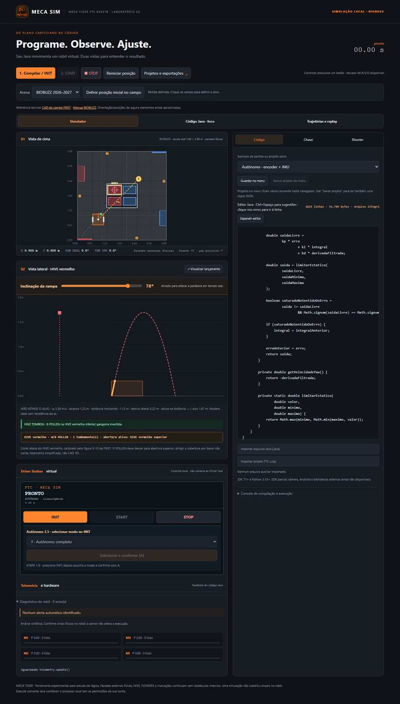
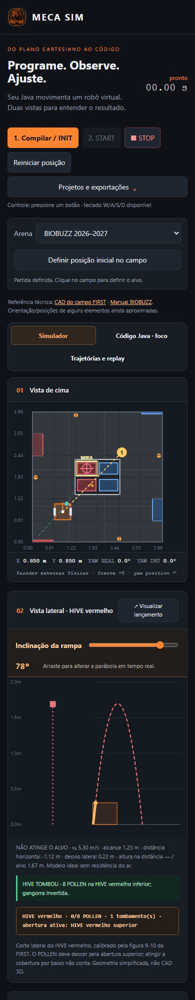

<div align="center">


<h1>Meca Sim</h1>

<p><strong>MECA TIGER · FTC #32578</strong><br>Laboratório 2D de programação e estratégia</p>

<p><strong>Escreva um OpMode. Rode localmente. Entenda cada movimento.</strong></p>

<p><a href="#comece-em-poucos-minutos">Começar</a> · <a href="#prévia-da-interface">Ver prévias</a> · <a href="#o-que-o-simulador-faz">Funcionalidades</a> · <a href="#limites-do-modelo-e-seguranca">Limites e segurança</a></p>

<p><a href="https://github.com/pabloinaciosilvestreinacio-collab/meca-sim/actions/workflows/validacao.yml"></a> </p>

</div>

O Meca Sim é um laboratório local para estudar lógica FTC da equipe Meca Tiger. Ele compila Java com `javac` e mostra o resultado numa arena 2D, telemetria e uma vista lateral do lançador. **Não precisa de conta ou serviço na nuvem.**

[Começar no Windows](#comece-em-poucos-minutos) · [Ver funcionalidades](#o-que-o-simulador-faz) · [Entender limites e segurança](#limites-do-modelo-e-seguranca)

> **Estado do projeto:** candidato experimental `0.3-rc2`. A interface é executada no seu computador. Ainda não é um simulador oficial nem substitui testes no robô físico.

## Prévia da interface

Capturas reais feitas pelo teste Chromium da CI em 13/10/2026. Elas mostram o aplicativo local; o simulador não está sendo executado dentro desta página.

<p align="center">
  
</p>

<details>
  <summary>Ver prévia em celular</summary>
  <p>A tela reorganiza os painéis em uma coluna, com controles e editor acessíveis por rolagem.</p>
  
</details>

[Ver execução de validação e evidências no GitHub Actions](https://github.com/pabloinaciosilvestreinacio-collab/meca-sim/actions/runs/38466750307).

## Comece em poucos minutos

### Windows: pacote portátil

1. Baixe o artefato **MecaSim-Windows-portatil** na [execução aprovada da CI](https://github.com/pabloinaciosilvestreinacio-collab/meca-sim/actions/runs/38466750307). Se ele expirar, abra [as execuções de validação](https://github.com/pabloinaciosilvestreinacio-collab/meca-sim/actions/workflows/validacao.yml?query=branch%3Amain) e escolha a mais recente aprovada na branch `main`.
2. Extraia o ZIP inteiro para uma pasta.
3. Instale ou localize um **JDK 17 ou mais recente**. O `java` e o `javac` precisam funcionar no terminal. O JDK do Android Studio também serve.
4. Execute `INICIAR_TESTE.bat`. Ele verifica o Java, inicia o servidor local e grava `mecasim-diagnostico.txt`.
5. No navegador, abra `http://127.0.0.1:8765` se não abrir automaticamente. Mantenha o terminal aberto enquanto usa o simulador.
6. Clique em **Compilar / INIT**, escolha um exemplo ou carregue seu OpMode; depois clique em **START**. Use **STOP** para parar.

O pacote inclui o servidor, a interface e o Python necessário. **O JDK continua necessário** para compilar e executar Java. O executável não tem assinatura e o Windows pode mostrar um aviso SmartScreen.

### Windows, Linux ou macOS: código-fonte

1. [Baixe o ZIP do repositório](https://github.com/pabloinaciosilvestreinacio-collab/meca-sim/archive/refs/heads/main.zip) e extraia todos os arquivos.
2. Instale Python 3.10+ e JDK 17+.
3. No Windows, execute `iniciar.bat`; no Linux/macOS, abra a pasta no terminal e rode `sh iniciar.sh`.
4. Acesse `http://127.0.0.1:8765` e mantenha o terminal aberto.

Para investigar uma falha de inicialização: `python iniciar.py --diagnostico` (Windows: `py -3 iniciar.py --diagnostico`). O servidor escuta somente no próprio computador.

## O que o simulador faz

### Campo, robô e movimento

- Alterna entre a arena **BIOBUZZ 2026–2027** e uma arena livre; a escala do modelo é 3,66 × 3,66 m.
- Mostra o robô em vista de cima com posição, orientação, rastro, mira e escala em metros. Clique no campo para apontar o lançador; use **Definir posição inicial no campo** ou Shift+clique para reposicionar antes do início.
- Permite configurar nomes e montagem dos motores, bitola, largura e comprimento do chassi, cor do robô e escala de encoders. Inclui uma calculadora de ticks, redução e diâmetro de roda.
- Oferece perfil diferencial (ME/MD), padrão da Mequinha, e perfil mecanum (FL/FR/BL/BR) como alternativa idealizada.
- Modela deslocamentos, giros, arcos, encoders e IMU/yaw. A integração de velocidade constante é exata no modelo; a execução em tempo real pode variar com o escalonamento do computador.
- As quatro paredes externas podem bloquear o chassi. Elementos internos do campo são visuais, sem colisão para o robô.

### Programação Java e ciclo do OpMode

- Edita e executa uma classe pública que estenda `LinearOpMode`, compilada localmente com o JDK real (`javac`). O ciclo tem **INIT, START e STOP**.
- Inclui exemplos de partida e aceita arquivos auxiliares Java, classes em vários arquivos e projetos JSON salvos.
- Importa vários `.java` de uma vez ou ZIP de projeto FTC com `TeamCode/src/main/java`; detecta OpModes e permite escolher qual executar. ZIP: até 1 MB; código Java descompactado: até 220 kB e 31 arquivos no importador ZIP.
- O editor oferece realce leve, sugestões por digitação ou Ctrl+Espaço, completar com Tab, contador de linhas/bytes e erros do compilador com arquivo e linha.
- O modo Autônomo 3.5 deixa selecionar uma rotina durante INIT, confirmar a escolha pelo Driver Station virtual e então iniciar.
- Projetos podem ser guardados numa biblioteca local do navegador (até 12), exportados e reabertos em JSON. Código importado também pode ser mantido como arquivos auxiliares.

### Chassi, hardware e sensores

- Painel de configuração do chassi e motores, comandos de potência, posição e ticks de encoder.
- Simula encoders lógicos, reset de encoder, IMU/yaw, `resetYaw()` e temporizadores.
- Permite ensaiar cenários artificiais: ganhos diferentes entre motores, aceleração limitada, patinagem, encoder travado e IMU travada, atrasada ou com deriva.
- Mostra telemetria Java e diagnóstico indicativo de IMU/encoder congelados, motor comandado sem avanço, possível polaridade invertida e timeout indicado pela telemetria.
- Tem Driver Station virtual com os controles INIT/START/STOP. **Não se conecta ao Driver Hub.**

### Controles e ensaio

- Aceita dois gamepads padrão com índices de botões preservados. O teclado pode substituir o jogador 1: W/S para `left_stick_y`, A/D para `right_stick_x`, espaço para A, além de B/X/Y e setas.
- Um gamepad conectado tem prioridade sobre o teclado do jogador 1; o jogador 2 mantém seu índice. LB/RB e gatilhos precisam de gamepad físico.
- Zera entradas quando a janela perde foco ou ficam sem atualização; para a execução ao ocultar a página ou perder o heartbeat do navegador. Inclui STOP, duração máxima e watchdog JVM.
- Oferece configuração de falhas de sensor e cenários para testar como o código reage. Esses valores são injetados para ensaio, não calibrados a partir de um robô real.

### Trajetórias, replay e exportação

- O **Editor de trajetórias** cria até 16 waypoints em metros e gera Java com giros relativos e deslocamentos por encoder. Avisa quando um trecho atravessa a base esquemática do HIVE; não calcula rota com desvio de obstáculos nem calibra PID.
- A **Linha do tempo** carrega a última trajetória registrada, com amostras de aproximadamente 0,05 s, seleção de instante e reprodução/pausa visual.
- Exporta o projeto e resultados em JSON e a trajetória temporal em CSV. Os projetos da biblioteca ficam no armazenamento local do navegador; exporte JSON para backup.
- Replay é somente visual: não pausa nem controla o Java, e não é determinístico.

### Shooter, HIVE e campo BIOBUZZ

- A aba **Shooter** configura posição do lançador presa ao chassi, altura, elevação, azimute e mira; a vista lateral exibe rampa, parábola, alvo e resultado estimado.
- Permite modo de força média equivalente ou velocidade de saída. A parábola usa gravidade padrão e um projétil pontual sem arrasto. O resultado SIM/NÃO considera alcance horizontal, desvio lateral e diferença de altura no alvo, com tolerâncias configuráveis; não representa pontuação oficial nem potência/RPM do mecanismo real.
- A arena apresenta HIVE, CELLS, FLOWERS, GARDENS e LOADING ZONES. As dimensões principais modeladas são: quadro HIVE 1,2565 × 0,9895 m, pivô a 1,1165 m, espaçamento das CELLS 0,478 m, abertura dos FLOWERS 0,546 m, GARDENS 0,584 × 0,051 m e LOADING ZONES 0,584 × 0,2795 m. Posições e orientações de elementos individuais continuam esquemáticas, não são uma reprodução CAD completa.
- Mira as quatro CELLS centrais do modo BIOBUZZ. O POLLEN viaja até a abertura, desacelera ao entrar e segue até o repouso visual dentro da CELL; o acerto é decidido durante o voo. Oito POLLEN no mesmo HIVE provocam uma animação didática de tombamento e troca da CELL ativa. O número oito não é uma regra oficial FIRST nem uma simulação de massa/impacto.
- As paredes externas são físicas no modelo. HIVE, FLOWERS e marcações não bloqueiam o robô; o lançador não simula mecanismos físicos, spin, arrasto ou impacto rígido.
- A opção **Inserir logo da equipe** permite carregar PNG/JPG/WebP no navegador. A imagem é reduzida e armazenada localmente; não é enviada ao GitHub ou a um servidor.

## Limites do modelo e segurança

- O SDK FTC é **parcial**. Não há compatibilidade integral com Gradle, Android, hardware real, bibliotecas externas, câmera/AprilTag ou Road Runner. Motores MS/MI guardam comandos e ticks idealizados; servos guardam posição lógica. `RUN_USING_ENCODER` não modela o controlador interno REV, e `RUN_TO_POSITION` é idealizado.
- A geometria do campo é parcialmente esquemática. A física é majoritariamente ideal: não valida pontuação, colisões internas, atrito/calibração, PID físico ou desempenho no robô da equipe.
- Java é compilado e executado **na sua máquina**, com as permissões do seu usuário. O processo não é isolado. Importe e execute apenas código de origem confiável; não exponha o servidor local à rede.
- O estado “concluído” significa que o programa Java terminou normalmente; uma rotina também pode terminar por timeout ou falha controlada. Confira a telemetria. A interface distingue yaw real da pose e yaw IMU recebido pelo Java.
- Bibliotecas e logo salvas no navegador podem ser perdidas ao limpar seus dados do site. Exporte cópias JSON.

## Testes e documentação técnica

Para rodar os testes reproduzíveis na raiz do repositório:

```sh
python -m unittest discover -s tests -v
node --test tests/model.test.mjs
python tests/repository_compatibility.py
python tests/fault_scenarios.py
```

O JDK é necessário para validar a integração Java. A CI roda Windows e Linux com Python 3.11, JDK 17, Node 22 e Chromium. Para reproduzir o teste da interface: instale `playwright==1.58.0`, execute `python -m playwright install chromium` e depois `python tests/browser_e2e.py`.

- [Cálculos e convenções](CALCULOS.md)
- [Relatório de validação](VALIDACAO.md)
- [Teste local](TESTE_LOCAL.md)
- [Mudanças por versão](CHANGELOG.md)
- [Próximas etapas](PLANEJAMENTO.md)

A origem do projeto está documentada no histórico e no `CHANGELOG.md`. Os commits são registrados neste repositório; uma evolução pode ser desfeita com `git revert <commit>`.
